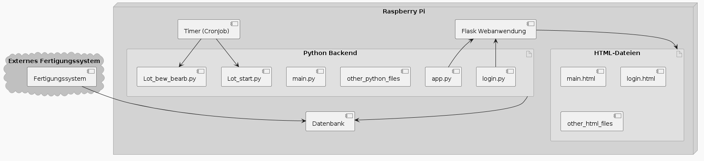

= Betriebsdokumentation

== Allgemeine Informationen

Die Betriebsdokumentation enthält Anleitungen und Hilfestellungen zum Einrichten, Konfigurieren und Betreuen des Systems. Dieses Dokument ist für Administratoren vorgesehen.

== Systemvoraussetzungen

=== Hardwareanforderungen

Raspberry Pi:

* Modell: 4B
* RAM: 8GB
* Speicherbedarf (SD-Karte): 32GB
* Internetverbindung: nicht notwendig(später nur Verbindung zum Fabrikbetrieb nötig)

=== Softwareanforderungen

* Betriebssystem: Raspberry Pi OS (rel.: 15.04.2024)
* genutzter Browser: Google Chrome(Ver.: 126.0)

== Systemeinrichtung

=== {counter:head1}.  Einrichtung des Backends

. Installation des Datenbankmanagementsystems PostgreSQL nach: +
https://pimylifeup.com/raspberry-pi-postgresql/ +
 + 
Beachte während der Installationsanleitung: +
 +
zu erstellender User: +
username: se-project +
password: se-project +
superuser: y +
 +
Name der DB: se-project + 

. downloade aus dem GitHub-Repo die SQL-Datei: DBanlegen_CSVeinfuegen.sql +
 +
Führe die Datei in PostgreSQL aus: +
[code,bash]
----
$ psql -U se-project -d se-project -f DBanlegen.sql
----

=== {counter:head1}.  Einrichtung des Frontends/Middleware

{counter:count2}. Installation der Python-Librarys:
[code,bash]
----
$ pip install -U Flask
$ pip install -U sqlalchemy
----

{counter:count2}. Einrichtung der Timers:
[code,bash]
----
$ echo "*/5 * * * * /usr/bin/phython ~/Desktop/i04-projekt-frau-holle/Lot_start.py >> ~/Desktop/i04-projekt-frau-holle/timer_log/log.txt 2>&1\n*/5 * * * * /usr/bin/phython ~/Desktop/i04-projekt-frau-holle/Lot_bew_bearb.py >> ~/Desktop/i04-projekt-frau-holle/timer_log/log.txt 2>&1" >> /etc/crontab
----

{counter:count2}. Herrunterladen der Programmdatein:
[code,bash]
----
$ cd ~/Desktop/i04-projekt-frau-holle
$ git clone "https://github.com/leni04/i04-projekt-frau-holle"
----

== Systembetreuung

=== {counter:head2}. Systembestandteile
Das folgende Diagramm soll eine Übersicht über die Verbindung der Systembestandteile bzw. -artefakte geben.

.Systembestandteile

.Systembestandteile

=== {counter:head2}. Speicherpfade
[%header, cols=2*]
|===
|Systembestandteil
|Speicherpfad

|Frontend (HTML)
|~/Desktop/i04-projekt-frau-holle/src/templates

|Frontend (CSS)
|~/Desktop/i04-projekt-frau-holle/src/static

|Middleware (.py Datein)
|~/Desktop/i04-projekt-frau-holle/src

|Start-Skript (standardmäßig)
|~/Desktop/i04-projekt-frau-holle/src/app.py

|===

=== {counter:head2}. Manuelles Starten/Stoppen

Starten:

[code,bash]
----
$ python src/app.py
----
Bei der Ausführung der Datei wird die IP-Adresse für die Oberfläche ausgegeben. +
 +
Stoppen: +
Tastenkombination: CTRL + C +

=== {counter:head2}. Füllen der Tabellen mit Beispieldatensätze

Wenn die Funktion der Datenbank getestet werden soll, können Bespieldatensätze, im CSV-Format, über die Import-Funktion der Oberfläche in die Datenbank eingefügt werden.
Einige Bespieldatensätze findet man im GitHub-Repository unter /docs/development/DB_Tabellen_erstellen/CSV-Data.

=== {counter:head2}. Backups

Erstellen Sie regelmäßig Backups der Datenbank und wichtiger Dateien:

Backup der PostgreSQL-Datenbank:

[code,bash]
----
$ pg_dump -U se-project -d se-project -f backup.sql
----

Wiederherstellen eines Backups:

[code,bash]
----
$ psql -U se-project -d se-project -f backup.sql
----

=== {counter:head2}. Updates und Wartung

Für Updates und Wartung sollten Sie regelmäßig die folgenden Schritte ausführen:

Aktualisieren Sie das Betriebssystem und installierte Pakete.

[code,bash]
----
$ sudo apt update && sudo apt upgrade
----

Aktualisieren Sie das GitHub-Repository auf die neueste Version.

[code,bash]
----
$ cd ~/Desktop/i04-projekt-frau-holle
$ git pull
----

=== {counter:head2}. Sicherheitsaspekte

Stellen Sie sicher, dass alle Sicherheitsupdates installiert sind und verwenden Sie starke Passwörter. Ändern Sie regelmäßig Passwörter und überprüfen Sie die Zugriffsrechte.

