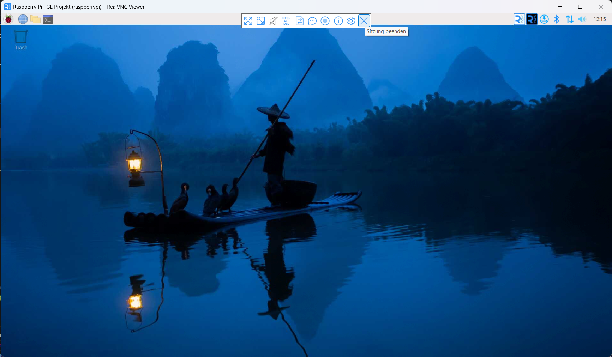

= Anleitung zur Remote-Verbindung mit dem Raspberry Pi

. *VNC Viewer installieren*
* Auf der Seite https://www.realvnc.com/de/connect/download/viewer/ den VNC Viewer für dein benutztes Betriebssystem herunterladen und installieren.

. *Nachfrage bei Richard*
* Da Richard den Raspberry Pi hat und ihn nicht dauerhaft angeschaltet hat, sollte eine Nachfrage bei ihm erfolgen, ob er ihn anschalten kann und ob er ihn angeschaltet lassen kann. Dann bekommt ihr eine IP-Adresse von ihm, die ihr für die Verbindung benötigt (diese ändert sich jedesmal).

. *Verbindung mit dem Raspberry Pi herstellen*
* VNC Viewer öffnen
* unter "Datei -> Neue Verbindung" öffnen
* bei VNC-Server die IP-Adresse von Richard eingeben
* bei Name einen beliebigen Namen eingeben
* Anmeldedaten für den Raspberry Pi eingeben:
    * Benutzername: admin
    * Passwort: password
* auf "Verbinden" klicken

. *Verbindung mit dem Raspberry Pi trennen*
* obige Taskleiste (siehe Screenshot) wird angezeigt, wenn man mit der Maus nach oben fährt
.Screenshot Raspberry Pi Benutzeroberfläche und "Sitzung beenden"-Button
