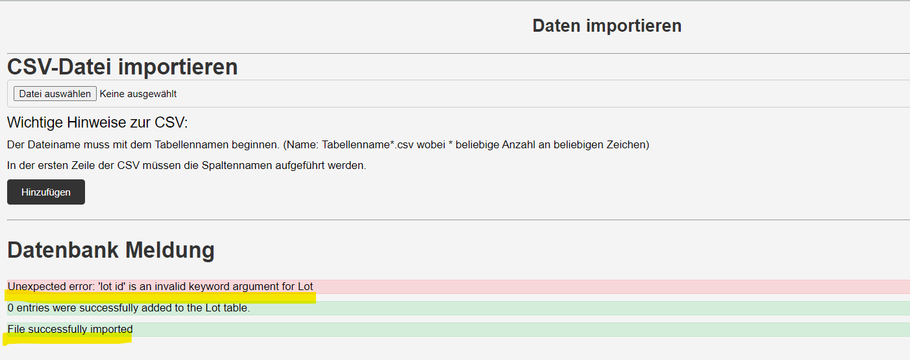

== Bugtracker - Fehlerliste

Der Bugtracker dient der schnellen Erfassung aller aufgetretenen Fehler und hält den jeweiligen Bearbeitungsstatus fest. Anhand der weiteren Testdokumentation kann bei Bedarf mithilfe der Test-ID der konkrete Test inkl. Eingabedaten u.v.m. eingesehen werden. 

*Test Case UC01 - Lose starten*

* TID 5: Filterfunktionen &#x2713;

*Test Case UC02 - Lose bewegen*

* Fehlende Funktionalität: Lose, die nach der Produktion auf HOLD gesetzt worden sind, müssen manuell geprüft werden. Der Use-Case muss es ermöglichen, dass der Folgezustand dieser Lose manuell auf SCRAP oder OP_COMP gesetzt werden kann (siehe im unteren Bereich von docs/test/docs/requirements/use_case_02_Hinweise_Implementierung.adoc.). Wir haben die UseCases etwas abweichend (aber gut!) von den Wireframes implementiert. Ursprünglich war ein LineEdit gedacht. Einfacher ist eventuell eine Lösung mit einem Dropdown mit allen Losen im Zustand HOLD. Wahlweise dann mit einem weiteren Dropdown der Zustände HOLD/SCRAP und einem Button zum Absenden oder kein Dropdown mit zwei unterschiedliche Button zum Setzen des Zustandes SCRAP oder OP_COMP. &#x2713;

*Test Case UC03 - Lose bearbeiten*

* *Nach Möglichkeit die grafische Oberfläche anpassen: Tabellenbreite expandieren und Trennlinien wie bei "Los starten" einfügen*
* Datenbank mit inkosistenten Variablen: Lot-Tabelle mit Distool|varchar(10) und Tool-Tabelle mit Tool|varchar(15) -> kann dazu führen, dass korrekt eingepflegte Maschinen der Tool-Tabelle das "Los bearbeiten" zum Absturz bringen &#x2713;

*Test Case UC04 - UC05 Stammdaten anzeigen/bearbeiten*

* TID1: Invalid Data Format beim Eintragen von Process started und EnterOper &#x2713;
* TID1: Customer lässt sich bei mir nicht editieren und lädt ohne Ergebnis &#x2713;
* NiceToHave: Tabellenhöhe auf mehr als 3 Zeilen erweitern -> bessere Lesbarkeit &#x2713;
* NiceToHave: Auto-Refresh der Tabelle, wenn der Button Submit gedrückt wird -> bessere Usability &#x2713;

*Test Case UC06-UC07 Daten importieren/eportieren*

* *TID2: Header beim Export sollte nach Möglichkeit den Beispieldatensätzen von Ringel entsprechen, sonst ist ein Import von exportierten Dateien aus unserem System nicht möglich. Das bedeutet: Exportdateien brauchen Spaltenüberschriten in Großbuchstaben und keine Leerzeichen zwischen den Kommata im Header*

* *TID2: beim Datei-Export (manuell) sind Spalten markiert, die laut Beschreibung ausgefüllt werden müssen. Es ist aber möglich z.B. ein Lot nur mit seiner ID einzupflegen. Hier müssten wir uns entscheiden, ob wir die Validierung der Eingaben ev. lieber an die Folgegruppe abgeben (ich denke, das wäre aus Zeigründen sinnvoll). Hier müsste eine Menge geprüft werden:
Zustände dürften nur den definierten Zuständen entsprechen. Ein Los im Zustand INIT hat kein ENTEROPER oder PROCSTART. Das Feld müsste also leer sein. Ein Los im Zustand PROC muss aber ein PROCSTART besitzen etc.*

* *Fehlermeldungen überschneiden sich teilweise. Zum Beispiel, wenn ein Import mit einem falschen Header stattfindet (z.B. Export aus unserem System), dann gibt es eine Fehlermeldung und der Vorgang wird abgebrochen. Gleichzeitig wird die Ausgabe "File successfully imported" angezeigt.*

* *NiceToHave: Zusätzlich Ausgabe der Zeilennummer bei Fehlermeldungen -> gerade bei großen Exports sind Fehler einfacher zu finden und zu korrigieren*
* *NiceToHave: Genauere Spezifikation, wie Header aufgebaut sein muss beim Datei-Import (z.B. Spaltenüberschriften in Großbuchstaben und durch Kommata getrennt; keine Leerzeichen erlaubt)*
