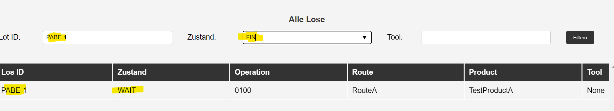

== Test Case UC01 - Lose starten

*Tests mit Fokus auf folgende Funktionalitäten:*

* Auftragsanlage
* Los starten (manuell + Timer)
* Datenvisualisierung über Los-Tabelle

'''
|===
| *Test-ID* | 1 
| *Zweck* | Verifikation Auftragsanlage
| *Testart* | Manuell, Positiv-Test
| *Vorbedingungen* | 
  - Fertigungsleiter oder Mitarbeiter ist in der Web-Anwendung angemeldet
  +
  - der Button "Los starten" wurde angeklickt, sodass die Eingabemaske erscheint
| *Testdurchführung* | 
 1. Eingabe: Customer, Order, Product, Amount of wafer, Due date, Time interval
  +
2. Auftragsanlage über Button "Register Order" abschließen
  +
3. Prüfung, ob das Los im Zustand INIT in die Datenbank übertragen worden ist und alle Eingaben korrekt übertragen worden (SELECT * FROM LOT)
| *Nachbedingungen* | 
- Bei erfolgreicher Testausführung befinden sich die zugehörigen Lose im Zustand INIT in der Datenbank
  +
- alle Wertefelder müssen korrekt in der Datenbank in der Tabelle "Lot" übertragen worden sein
  +
| *Eingabedaten* | 

Customer:     Paul
  +
Order: Bestellung_2
  +
Product: TestProductA
  +
Due date: 09,06.2024
  +
Time interval: 08.05.2024-09,05.2024
  +

| *Ergebnis* | PASS
| *To-dos* | /
| *Korrekturstatus* | /
|===

'''

|===
| *Test-ID* | 2 
| *Zweck* | Verifikation Auftragsanlage
| *Testart* | Manuell, Negativ-Test
| *Vorbedingungen* | 
  - Fertigungsleiter oder Mitarbeiter ist in der Web-Anwendung angemeldet
  +
  - der Button "Los starten" wurde angeklickt, sodass die Eingabemaske erscheint
| *Testdurchführung* | 
 1. Eingabe: Customer, Order, Product, Amount of wafer, Due date, Time interval
  +
2. Auftragsanlage über Button "Register Order" abschließen
  +
3. Prüfung, ob das System fehlende Eingaben erkennt
  +
4. Prüfung, ob invalide Datumskombinationen erkannt werden (due date < start date, end date < start date, start date/current date/end date < current date)
  +
| *Nachbedingungen* | 
- Bei erfolgreicher Testausführung erscheinen deskriptive Fehlermeldungen. 
  +
- das Los darf nicht auf der Datenbank eingeplant werden
  +
| *Eingabedaten* | 

 Analog zu TID1

| *Ergebnis* | PASS
| *To-dos* | /
| *Korrekturstatus* | /
|===

'''

|===
| *Test-ID* | 3 
| *Zweck* | Verifikation Los manuell starten
| *Testart* | Manuell, Positiv-Test
| *Vorbedingungen* | 
  - Fertigungsleiter oder Mitarbeiter ist in der Web-Anwendung angemeldet
  +
  - der Button "Los starten" wurde angeklickt
| *Testdurchführung* | 
 1. Eingabe bzw. Auswahl eines Loses, welches gestartet werden soll und sich im Zustand INIT befindet
  +
2. Los über den Button "Start Lot" starten
  +
3. Prüfung, ob die zugehörige Los-Tabelle aktualisiert wird
  +
4. Prüfung, ob Los-Zustand von INIT auf WAIT wechselt; Prüfung, ob Operation und Route gesetzt werden
  +
| *Nachbedingungen* | 
Bei erfolgreicher Testausführung wird das Los korrekt in den Fertigungsprozess eingebunden 
| *Eingabedaten* | 

Auswahl eines beliebigen Loses mit dem Zustand INIT

| *Ergebnis* | PASS
| *To-dos* | /
| *Korrekturstatus* | /
|===

'''

|===
| *Test-ID* | 4 
| *Zweck* | Verifikation Los manuell starten
| *Testart* | Manuell, Negativ-Test
| *Vorbedingungen* | 
  - Fertigungsleiter oder Mitarbeiter ist in der Web-Anwendung angemeldet
  +
  - der Button "Los starten" wurde angeklickt
| *Testdurchführung* | 
 1. Fehlerhafte Eingaben: Los nicht im Zustand INIT; Falsche LosID
  +
2. Los über den Button "Start Lot" starten
  +
3. Prüfung, ob deskriptive Fehlermeldungen ausgegeben werden
  +
| *Nachbedingungen* | 
Bei erfolgreicher Testausführung wurde kein fehlerhaftes Los gestartet
| *Eingabedaten* | 

Auswahl eines beliebigen Loses mit dem Zustand !=INIT und Eingabe einer fehlerhaften Los ID (z.B. xy34950)

| *Ergebnis* | PASS
| *To-dos* | /
| *Korrekturstatus* | /
|===

'''

|===
| *Test-ID* | 5 
| *Zweck* | Verifikation Filteroptionen der Los-Tabelle
| *Testart* | Manuell, Positiv-Test
| *Vorbedingungen* | 
  - Fertigungsleiter oder Mitarbeiter ist in der Web-Anwendung angemeldet
  +
  - der Button "Los starten" wurde angeklickt
| *Testdurchführung* | 
 1. Diverse Filterkombinationen im Drop-Down-Menü auswählen
  +
2. Kontrolle, ob die Datensätze korrekt gefiltert werden und sich die Los-Tabelle automatisch aktualisiert
  +
| *Nachbedingungen* | 
Bei erfolgreicher Testausführung befindet sich alle Lose, die den Filterkriterien entsprechen, in der Los-Tabelle
| *Eingabedaten* | 

Auswahl aller Zustände in Kombinationen mit stichprobenartig ausgewählten Maschinen und Losen

| *Ergebnis* | FAIL
| *To-dos* | 
Das Filtern der Lose funktioniert nach dem Prinzip, dass alle Lose angezeigt werden, bei denen mindestens 1 Suchkriterium wahr ist. Es muss sichergestellt sein, dass alle Suchkriterien gleichzeitig zutreffen (siehe Screenshot).
| *Korrekturstatus* | DONE
|===

.TID 5: Fehlerhafter Filter

'''

|===
| *Test-ID* | 6 
| *Zweck* | Verifikation Timer-Funktion Los starten
| *Testart* | Unit-Test, Positiv-Test
| *Vorbedingungen* | 
  Aufruf des Projektes in der Entwicklungsumgebung und Start der Applikation
| *Testdurchführung* | 
 1. Ausführung des Moduls TC_UC1_TID6.py, welches die Timer-Funktion lot_start aufruft.
  +
2. Lose im Zustand INIT einpflegen und Variable für das Startdatum in den gültigen Bereich setzen
  +
3. Kontrolle, ob der Test erfolgreich durchläuft und die richtige Lose im Zustand INIT und WAIT ausgegeben werden
  +
| *Nachbedingungen* | 
Bei erfolgreicher Testausführung wechseln für das gewählte Startdatum alle Lose vom Zustand INIT in den Zustand WAIT
| *Eingabedaten* | 

Anlegen eines Loses und Setzen eines Startdatums<currenttime

| *Ergebnis* | PASS
| *To-dos* | /
| *Korrekturstatus* | /
|===

